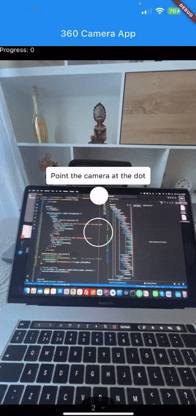

# 360 Camera

This plugin allows users to take 360° panoramic images using the phone's camera. OpenCV stitches the frames together on-device using SIFT, ORB, AKAZE, or BRISK feature matching. Alternatively, a SuperPoint + LightGlue ONNX pipeline can be used for higher-quality feature matching.

A simple UI guides the user through capture by showing orientation dots on screen.

### Demo

Checkout [Tridiar - Virtual Tours](https://tridiar.com) on [iOS](https://apps.apple.com/us/app/tridiar/id1593706196) and [Android](https://play.google.com/store/apps/details?id=com.tridiar.agent)



## Installation

### iOS

ONNX Runtime requires minimum version `iOS 16` and static linkage.

In `ios/Podfile`, change the following lines:

```bash
platform :ios, '16.0'

# existing code ...

use_frameworks! :linkage => :static

# existing code ...
```

Add these lines to `Info.plist`:

```plist
<key>NSCameraUsageDescription</key>
<string>This application needs access to your Camera in order to capture 360 Images</string>
<key>NSMicrophoneUsageDescription</key>
<string>This application needs access to your Microphone in order to capture videos</string>
<key>NSPhotoLibraryUsageDescription</key>
<string>This application needs access to your Photo Library in order to save the captured images</string>
```

### Android

Set the minimum SDK to 21 (or higher) in `android/app/build.gradle`:

```properties
minSdkVersion 21
```

In `AndroidManifest.xml`:

```xml
<uses-permission android:name="android.permission.WRITE_EXTERNAL_STORAGE" />
```

Android build requires `proguard-rules.pro` inside your Android project at `android/app/` with the following content:

```
-keep class ai.onnxruntime.** { *; }
```

or running the below command from your terminal:

```bash
echo "-keep class ai.onnxruntime.** { *; }" > android/app/proguard-rules.pro
```

### Dart

```dart
import 'package:camera_360/camera_360.dart';

Camera360(
  // ── Capture settings ────────────────────────────────────────────────────────
  photoCount: 16,                  // frames per 360° rotation
  captureVerticalDeg: 90,          // 90 = horizon, < 90 = tilted down, > 90 = tilted up
  loadingText: 'Preparing panorama...',
  helperText: 'Point the camera at the dot',
  tiltLeftText: 'Tilt left',
  tiltRightText: 'Tilt right',

  // ── Camera selector UI ──────────────────────────────────────────────────────
  cameraSelectorShow: true,
  cameraSelectorInfoPopUpShow: true,

  // ── Stitching (native OpenCV pipeline) ─────────────────────────────────────
  stitchModel: StitchFeatureModel.sift,
  stitchLoop360: true,
  stitchLoopClosure: true,          // tonal wrap-seam fix (360° only)
  stitchCrop: StitchCropMode.inner,
  stitchFallback: true,
  stitchFill: true,
  stitchFillRatio: 2.0,
  stitchFillSource: 30,
  stitchFillBlur: 401,
  stitchFillFade: 50,
  stitchFillBlurRatio: 0.01,
  stitchFillFadePower: 5.0,

  onCaptureEnded: (data) {
    // { 'success': bool, 'panorama': XFile?, 'options': { ... } }
    if (data['success'] == true) {
      final XFile panorama = data['panorama'];
      print('Panorama saved: ${panorama.path}');
    }
  },
  onProgressChanged: (percent) => print('Capture: $percent%'),
  // Optional: replace the built-in stitch overlay (see "Stitch progress" below)
  // stitchingProgressBuilder: (context, stage, percent) => MyStitchOverlay(...),
),
```

> `onCaptureEnded` returns an `XFile` on success, or `null` if stitching failed.

`Camera360` reads its constructor options once at init. To change capture or stitch settings, give the widget a new [Key] (e.g. `ValueKey`) so Flutter disposes the old instance and mounts a fresh one. The example app does this for every option change.

## Capture options

| Parameter             | Type      | Default                         | Description                                                        |
| --------------------- | --------- | ------------------------------- | ------------------------------------------------------------------ |
| `photoCount`          | `int?`    | `16`                            | Number of frames captured in a full 360° rotation                  |
| `captureVerticalDeg`  | `double`  | `90`                            | Vertical angle the device should be held at (0..180; 90 = horizon) |
| `captureImageWidth`   | `int?`    | `1000`                          | Width each captured frame is resized to before stitching           |
| `captureImageQuality` | `int?`    | `50`                            | JPEG quality for frame resize (1–100)                              |
| `loadingText`         | `String?` | `'Preparing panorama...'`       | Fallback label before stitch progress starts (see Stitch progress) |
| `helperText`          | `String?` | `'Point the camera at the dot'` | Instruction text during capture                                    |
| `tiltLeftText`        | `String?` | `'Tilt left'`                   | Text shown when the device needs tilting left                      |
| `tiltRightText`       | `String?` | `'Tilt right'`                  | Text shown when the device needs tilting right                     |
| `debug`               | `bool`    | `false`                         | Show live orientation readouts (horizontal, target, vertical, tilt) during capture |
| `debugInfoPosition`   | `DebugInfoPosition` | `DebugInfoPosition.topLeft` | Corner and inset for the debug overlay (see below)                 |
| `saveCapturedImages`  | `bool`    | `false`                         | Copy each captured frame to the device photo gallery before cache cleanup |
| `captureStartButtonBuilder` | `CaptureStartButtonBuilder?` | `null` (built-in shutter button) | Custom start-capture control shown before capture begins |
| `captureResetButtonBuilder` | `CaptureResetButtonBuilder?` | `null` (built-in dark Reset) | Custom reset control during capture; pass [hideCaptureResetButton] to hide |

### Capture control buttons

Before capture, the default start control is a red shutter dot with a white ring on a dark translucent backing ([DefaultCaptureStartButton]). During capture, the default reset control is a dark pill-shaped **Reset** button ([DefaultCaptureResetButton]).

```dart
Camera360(
  // Custom start shutter
  captureStartButtonBuilder: (onStart, enabled) => MyStartButton(onPressed: onStart),
  // Hide reset entirely
  captureResetButtonBuilder: hideCaptureResetButton,
  // Custom reset
  captureResetButtonBuilder: (onReset) => MyResetButton(onPressed: onReset),
)
```

### Debug orientation overlay

When `debug` is true, a semi-transparent panel shows cumulative horizontal heading, target horizontal heading, vertical angle, and camera-axis tilt while capture is active. Toggle it independently of `saveCapturedImages`.

Placement is controlled with `debugInfoPosition`:

```dart
Camera360(
  debug: true,
  // Presets: topLeft, topRight, bottomLeft, bottomRight
  debugInfoPosition: DebugInfoPosition.bottomRight,
  // Or custom corner + inset:
  debugInfoPosition: DebugInfoPosition(
    alignment: DebugInfoAlignment.topRight,
    padding: EdgeInsets.only(top: 16, right: 12),
  ),
  // ...
)
```

When `saveCapturedImages` is true, each frame is saved to the photo library via `gallery_saver_plus` before the plugin deletes its cache after stitching. Requires photo-library permission (see Installation).

## Stitching options

All options below are passed to the native `stitch()` function.

| Parameter             | Type                 | Default | Description                                                                                         |
| --------------------- | -------------------- | ------- | --------------------------------------------------------------------------------------------------- |
| `stitchModel`         | `StitchFeatureModel` | `sift`  | Feature detector: `sift`, `orb`, `akaze`, `brisk`, or `onnx`                                        |
| `onnxModelAssetKey`   | `String?`            | `null`  | Flutter asset key for the SuperPoint + LightGlue ONNX model (required when `stitchModel` is `onnx`) |
| `stitchLoop360`       | `bool`               | `true`  | Match last frame to first for a closed 360° loop                                                    |
| `stitchLoopClosure`   | `bool`               | `true`  | Lightweight tonal alignment + feather at the wrap seam (only when `stitchLoop360` is true)          |
| `stitchCrop`          | `StitchCropMode`     | `inner` | `none` — full canvas; `bbox` — tight bounding box; `inner` — largest rectangle with no black wedges |
| `stitchFallback`      | `bool`               | `true`  | Synthesize homographies for failed adjacent pairs                                                   |
| `stitchFill`          | `bool`               | `true`  | Pad top/bottom with blurred edge fill                                                               |
| `stitchFillRatio`     | `double`             | `2.0`   | Target width/height when fill is enabled (e.g. `2.0` = 2:1)                                         |
| `stitchFillSource`    | `int`                | `30`    | Rows sampled from each edge for the blur profile                                                    |
| `stitchFillBlur`      | `int`                | `401`   | Horizontal Gaussian kernel (odd, ≥ 3)                                                               |
| `stitchFillFade`      | `int`                | `50`    | Pano rows at the join blended with the edge profile                                                 |
| `stitchFillBlurRatio` | `double`             | `0.01`  | Fraction of fill band that stays pure blur                                                          |
| `stitchFillFadePower` | `double`             | `5.0`   | Fade steepness toward flat colour (`1.0` = linear)                                                  |

`stitchCrop` and `stitchFill` are independent: e.g. `stitchCrop: StitchCropMode.none` with `stitchFill: true` still fills black wedges using a per-column boundary.

## Stitch progress

While frames are being stitched, the plugin reports live **stage** and **overall percent** (0–100) for both OpenCV and ONNX pipelines. Feature finding and matching take the largest share of the bar; composition stages share the remainder.

| Pipeline                  | Typical stages shown                                                                         |
| ------------------------- | -------------------------------------------------------------------------------------------- |
| OpenCV (`sift`, `orb`, …) | Detecting features → Matching features → Bundle adjustment → Warping → Blending → Finalising |
| ONNX                      | Preprocessing → Matching features → _(native compose stages)_                                |

**Capture vs stitch:** `onProgressChanged` tracks rotation progress during capture only. Stitch progress is shown in the loading overlay automatically.

| Parameter                  | Type                        | Default | Description                                                        |
| -------------------------- | --------------------------- | ------- | ------------------------------------------------------------------ |
| `stitchingProgressBuilder` | `StitchingProgressBuilder?` | `null`  | Custom stitch overlay; built-in label + bar + percent when omitted |

### Default overlay

If you omit `stitchingProgressBuilder`, a built-in overlay shows the current stage label, a linear progress bar, and the overall percentage.

### Custom overlay

```**dart**
Camera360(
  stitchingProgressBuilder: (context, stage, percent) {
    return Center(
      child: Column(
        mainAxisSize: MainAxisSize.min,
        children: [
          Text(stage, style: const TextStyle(color: Colors.white)),
          const SizedBox(height: 8),
          LinearProgressIndicator(value: percent / 100),
          Text('$percent%', style: const TextStyle(color: Colors.white70)),
        ],
      ),
    );
  },
  // ...
)
```

`stitchingProgressBuilder` receives English stage labels by default; translate them inside the builder for i18n.

## SuperPoint + LightGlue ONNX feature matching

For higher-quality panoramas (especially in low-texture scenes) you can use a SuperPoint + LightGlue ONNX pipeline instead of OpenCV's built-in detectors.

### Setup

The model is not bundled with the plugin — you need to include it in your app's assets. Add it to your `pubspec.yaml`:

You can download the model from: https://github.com/fabio-sim/LightGlue-ONNX/releases/tag/v2.0 (`superpoint_lightglue_pipeline.ort.onnx`)

```yaml
flutter:
  assets:
    - models/
```

Place the model file (e.g. `superpoint_lightglue_pipeline.ort.onnx`) in `<your_app>/models/`.

### Usage

```dart
Camera360(
  stitchModel: StitchFeatureModel.onnx,
  onnxModelAssetKey: 'models/superpoint_lightglue_pipeline.ort.onnx',
  // ...other options
),
```

The plugin automatically copies the bundled asset to a writable directory on first use (skipping the copy on subsequent runs when the file is unchanged). If the asset key cannot be found, a descriptive error is thrown.

## Direct stitching API

You can also stitch a list of images outside the capture UI:

```dart
import 'package:camera_360/camera_360.dart';

final panorama = await Stitcher.stitchImages(
  imageFiles,
  model: StitchFeatureModel.sift,
  loop360: true,
  loopClosure: true,
  crop: StitchCropMode.inner,
  fill: true,
  fillRatio: 2.0,
  onStitchProgress: (stage, percent) {
    print('$stage: $percent%');
  },
);
```

Stitching runs in a background isolate so the UI stays responsive. Progress is polled from native code on the main isolate (~20 Hz) via `stitch_get_progress`; for ONNX, run `OnnxFeaturePipeline.compute` first and pass the resulting `featuresBlob`, then use the same `onStitchProgress` callback (matching reports 0–65%, compose 65–100%).

## Example app

The `example/` app includes **Capture** and **Stitch** menus. Changing any option assigns a new `ValueKey` to `Camera360`, reinitializing the widget with the updated configuration. The Capture menu exposes **Show orientation info** (`debug`), **Info position** (`debugInfoPosition`), and **Save captures to gallery** (`saveCapturedImages`).

```bash
cd example && flutter run
```

## Developer documentation

Native C++ development (macOS test harness, CMake, CLI flags): [doc/developer.md](doc/developer.md)

Regenerate FFI bindings after changing `src/umbrella/Stitcher/Stitcher.h`:

```bash
flutter pub run ffigen --config ffigen.yaml
```
